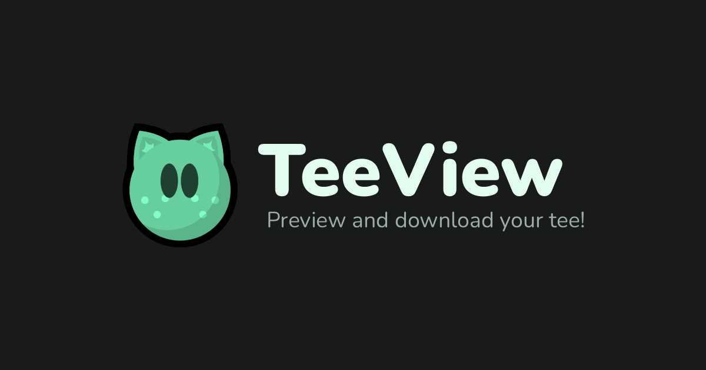

<div align="center">

<a href="https://teeview.meeu.me/">
  
</a>

<br>

[](https://teeview.meeu.me/)
[](package.json)
[](LICENSE)

[](https://vuejs.org/)
[](https://www.typescriptlang.org/)
[](https://vite.dev/)
[](https://sass-lang.com/)
[](https://teeview.meeu.me/)
[](https://github.com/meeuchan/teeview/stargazers)

[**Open TeeView**](https://teeview.meeu.me/) &nbsp;·&nbsp; [Report a bug](https://github.com/meeuchan/teeview/issues) &nbsp;·&nbsp; [Support on Ko-fi](https://ko-fi.com/meeuchan)

</div>

---

## ✨ Features

|                           |                                                                                                                                         |
| ------------------------- | --------------------------------------------------------------------------------------------------------------------------------------- |
| **Load skin**             | Upload a `.png` or `.svg`, enter a skin name or URL, or paste a console command from [DDstats](https://ddstats.tw).                     |
| **Custom colors**         | Tweak body and feet colors just like in-game, using color sliders or color codes from the game.                                         |
| **Eyes**                  | Pick an expression and set the look direction, or hide the face entirely.                                                               |
| **Poses**                 | Pick a pose. Hide the feet or toggle DDfat.                                                                                             |
| **Weapons**               | Pick a weapon. Use the default gameskin or load your own.                                                                               |
| **Export**                | Copy or download as full size, emoji (perfect for Discord emotes), smart crop, or smart crop emoji.                                     |
| **Offline & Installable** | Works as a Progressive Web App, so you can open it offline as long as you've load it once, or install it and open it like a native app. |

### Skin sources

When you load a skin by name, TeeView looks it up in these databases, in order:

1. [skins.ddstats.tw](https://skins.ddstats.tw/)
2. [ddnet.org/skins/skin/community](https://ddnet.org/skins/skin/community/)
3. [ddnet.org/skins/skin](https://ddnet.org/skins/skin/)

## 🛠️ Development

**Requirements:** [Node.js](https://nodejs.org/) 22+

```sh
git clone https://github.com/meeuchan/teeview.git
cd teeview
npm install
npm run dev
```

| Command           | Description                                          |
| ----------------- | ---------------------------------------------------- |
| `npm run dev`     | Start the dev server with hot reload                 |
| `npm run build`   | Type-check, compile and minify for production        |
| `npm run preview` | Preview the production build locally                 |
| `npm run lint`    | Lint and auto-fix with [ESLint](https://eslint.org/) |
| `npm run format`  | Format `src/` with [Prettier](https://prettier.io/)  |

### Project structure

```
src/
├── components/   # Vue components (option tabs, inputs, UI primitives, icons)
├── lib/          # Rendering engine: skin parts, tee colors, canvas, gameskin, export
├── assets/       # Global SCSS (reset, variables)
└── utils.ts      # Skin fetching & command parsing helpers
```

## 🤝 Contributing

Found a bug or have an idea? [Open an issue](https://github.com/meeuchan/teeview/issues) or send a pull request.

[](https://ko-fi.com/meeuchan)

## 📄 License

[MIT](LICENSE)
